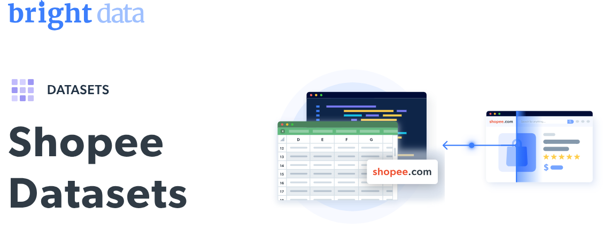

# Shopee 数据集示例

<h2>包含 1001 个 Shopee 商品的示例数据集</h2>


一个包含 1000 多个商品的 Shopee 数据集示例。数据集使用 <b>Bright Data API</b> 提取。

<h2>此免费数据集中包含的数据点：</h2>

* ```id```：Shopee 上该商品的唯一标识符
* ```title```：商品的标题或名称
* ```url```：商品在 Shopee 上页面的链接
* ```final_price```：商品在折扣或促销后的当前/最终价格
* ```initial_price```：商品的原价或起始价格
* ```currency```：价格所使用的货币
* ```rating```：该商品的客户平均评分
* ```reviews```：该商品获得的评论数
* ```stock```：该商品当前库存
* ```favorite```：将其加入收藏的人数
* ```image```：商品图片的 URL 或引用
* ```video```：与商品相关的视频
* ```seller_name```：提供该商品的卖家名称
* ```shop_url```：卖家店铺的链接
* ```breadcrumb```：指示商品在网站结构中位置的面包屑路径
* ```product_description```：商品的文字描述
* ```product_specifications```：商品的规格或详细信息
* ```seller_rating```：卖家的平均评分
* ```seller_products```：卖家店铺中的商品数量
* ```seller_chats_responded_percentage```：卖家回复聊天的百分比
* ```seller_chat_time_reply```：卖家回复聊天的平均用时
* ```seller_joined_date```：卖家加入 Shopee 的日期
* ```seller_followers```：卖家的关注者数量
* ```sold```：已售出件数
* ```variations```：商品的变体信息

以及更多。

这是从“Shopee Properties Information（公共数据）”数据集中提取的一个样本子集，完整数据集包含超过 <b>11,000,000 家公司</b>的数据。

可用的数据集文件格式：<b>JSON、NDJSON、JSON Lines、CSV 或 Parquet。文件可选支持 .gz 压缩</b>。

数据集交付方式：<b>电子邮件、API 下载、Webhook、Amazon S3、Google Cloud Storage、Google Cloud Pub/Sub、Microsoft Azure、Snowflake、SFTP</b>。

更新频率：<b>一次性、每日、每周、每月、每季度，或自定义</b>。

可提供数据增强，作为对已提取数据点的补充：<b>按需提供</b>。

<b>[获取完整 Shopee 数据集](https://www.bright.cn/products/datasets/shopee)</b>。



<h2>Shopee 数据集的应用场景有哪些？</h2>

<h3>1. 价格优化</h3>

通过将 Shopee 商品与品类与竞争对手进行对比，构建动态定价模型并制定定制化定价策略。

<h3>2. 缺口分析</h3>

发现 Shopee 商品结构中的库存缺口，跟踪特定品类需求上升趋势，挖掘正受到消费者关注的热门商品。

<h3>3. 市场策略优化</h3>

利用 Shopee 数据集进行深入的市场策略分析，精准定位关键趋势与用户偏好变化。

<h2>为学术研究者和非政府组织提供免费网络数据抓取工具与数据集</h2>

Bright Initiative 向领先的高校与研究人员、以及推动各类环保与社会公益事业的 NGO/NPO 提供对 Bright Data 的 <b>[Web Scraper APIs](https://www.bright.cn/products/web-scraper)</b> 和 <b>[现成可用的数据集](https://www.bright.cn/products/datasets)</b> 的访问权限。您可以在此提交申请：<b>[点击这里](https://brightinitiative.com)</b>。
