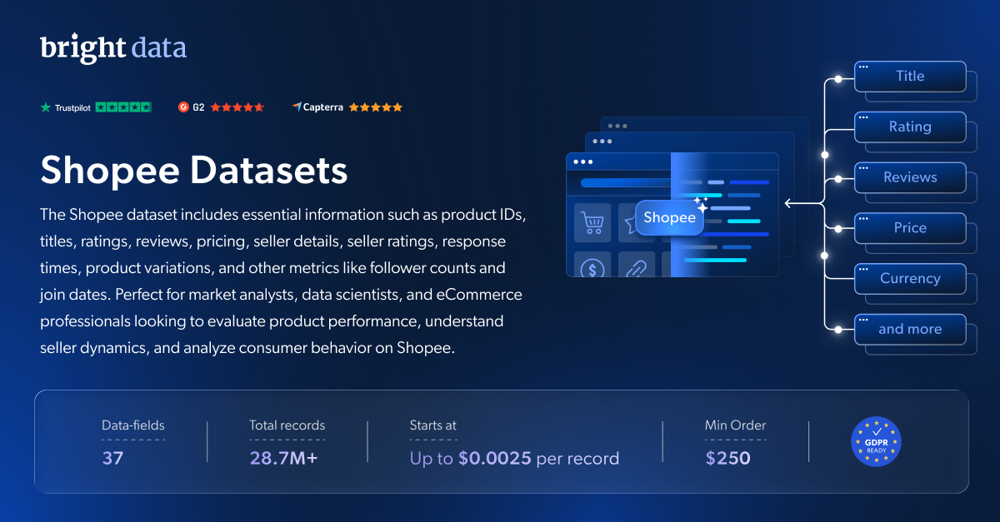

# Shopee-dataset-samples

<h2>包含 1001 件 Shopee 商品的示例数据集</h2>

<a href="https://www.bright.cn/products/datasets/shopee">
   
</a>

包含 1000 多件商品的 Shopee 数据集样本。该数据集使用 <b>Bright Data API</b> 提取。

<h2>此免费数据集包含的数据点：</h2>

* ```id```：商品在 Shopee 上的唯一标识符
* ```title```：商品的标题或名称
* ```url```：Shopee 商品页面的 URL 或链接
* ```final_price```：应用所有折扣或促销后的商品当前价格或最终价格
* ```initial_price```：商品的原价或起始价格
* ```currency```：标价所使用的货币
* ```rating```：客户为商品给出的平均评分
* ```reviews```：商品收到的评论数量
* ```stock```：商品的当前库存或存货数量
* ```favorite```：将商品添加到收藏的人数
* ```image```：商品图片的 URL 或引用
* ```video```：与商品相关的视频
* ```seller_name```：商品卖家的名称
* ```shop_url```：卖家店铺的 URL 或链接
* ```breadcrumb```：指示商品在网站结构中所处位置的面包屑导航路径
* ```product_description```：商品的文本描述
* ```product_specifications```：商品的规格或详细信息
* ```seller_rating```：卖家的平均评分
* ```seller_products```：卖家店铺中的商品数量
* ```seller_chats_responded_percentage```：卖家回复聊天消息的比例
* ```seller_chat_time_reply```：卖家回复聊天消息的平均用时
* ```seller_joined_date```：卖家入驻 Shopee 的日期
* ```seller_followers```：卖家的关注者数量
* ```sold```：商品销量
* ```variations```：商品变体信息

以及更多内容。

这是从“Shopee 商品信息（公开数据）”数据集中提取的示例子集，该数据集包含超过 <b>11,000,000 家企业</b>。

可用的数据集文件格式：<b>JSON、NDJSON、JSON Lines、CSV 或 Parquet。文件还可选择压缩为 .gz 格式</b>。

数据集交付方式：<b>电子邮件、API 下载、Webhook、Shopee S3、Google Cloud Storage、Google Cloud PubSub、Microsoft Azure、Snowflake、SFTP</b>。

更新频率：<b>单次、每日、每周、每月、每季度或自定义周期</b>。

可在提取的数据点基础上添加数据增强：<b>按需提供。</b>

<b>[获取完整的 Shopee 数据集](https://www.bright.cn/products/datasets/shopee)</b>。


<a href="https://www.bright.cn/products/datasets/shopee">
   
</a>

<h2>Shopee 数据集有哪些应用场景？</h2>

<h3>1. 定价优化</h3>

通过将 Shopee 的商品及品类与竞争对手的产品进行比较，构建动态定价模型并制定量身定制的定价策略。

<h3>2. 差距分析</h3>

发现 Shopee 商品阵容中的库存缺口，追踪特定商品不断增长的需求，并找出越来越受消费者青睐的商品。

<h3>3. 市场策略优化</h3>

利用 Shopee 数据集深入分析市场策略，确定关键趋势和客户偏好变化。

<h2>学术研究人员和非政府组织可免费使用网页爬虫工具和数据集</h2>

Bright Initiative 为顶尖院系和学术研究人员，以及致力于推动各类环境与社会事业的非政府组织和非营利组织提供 Bright Data 的 <b>[网页爬虫工具 API](https://www.bright.cn/products/web-scraper)</b> 和 <b>[即用型数据集](https://www.bright.cn/products/datasets)</b>。你可以在<b>[此处](https://brightinitiative.com)</b>提交申请。
